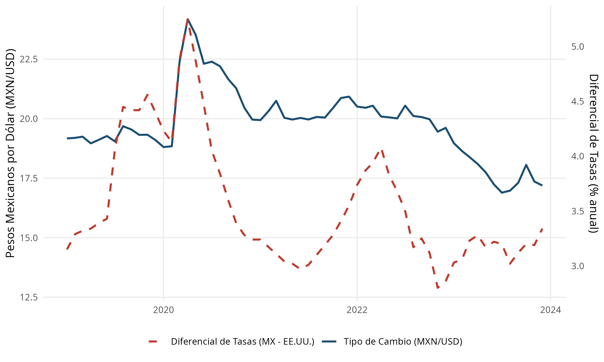
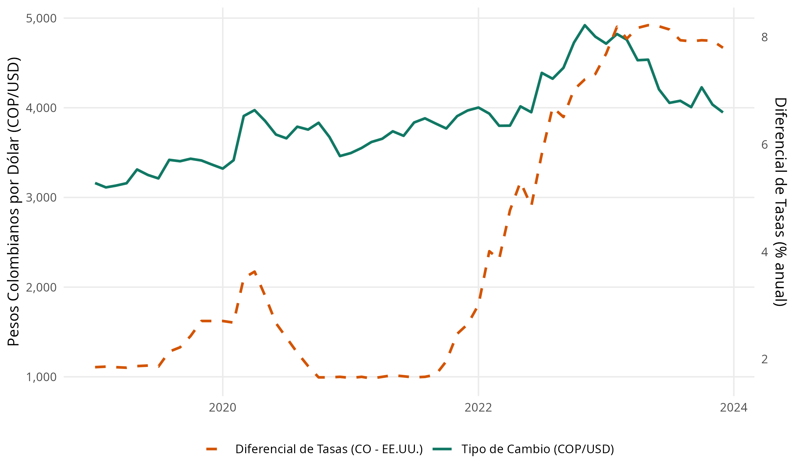
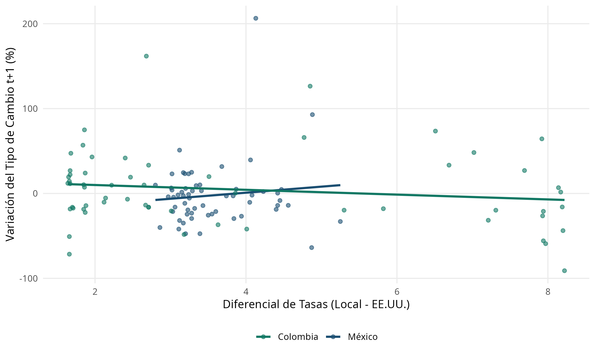

Explicación del modelo de Fama (1984)
================

- [Generalidades](#generalidades)
- [Modelo de Fama (1984)](#modelo-de-fama-1984)
- [Resultados](#resultados)
- [Gráficos](#gráficos)
- [Conclusión](#conclusión)
- [Bibliografia](#bibliografia)

## Generalidades

Este documento analiza la relación entre las tasas de interés y el tipo
de cambio en México y Colombia. Primero se presentan los conceptos
principales y luego se muestran los resultados de la regresión de Fama.

Las tasas de interés de Estados Unidos, México y Colombia corresponden a
series de la OCDE consultadas en FRED (Organization for Economic
Co-operation and Development 2026d, 2026c, 2026b). Para los tipos de
cambio se utilizaron la serie MXN/USD de la Reserva Federal de Estados
Unidos (Board of Governors of the Federal Reserve System 2026) y la
serie COP/USD de la OCDE (Organization for Economic Co-operation and
Development 2026a), también consultadas en FRED.

### Paridad Descubierta de Tasas de Interés (UIRP)

La UIRP plantea que la diferencia entre la tasa de interés local y la
extranjera debe corresponder a la depreciación esperada de la moneda
local durante el mismo periodo. En otras palabras, una tasa local más
alta debería compensarse con una depreciación esperada. Esta idea parte
de supuestos como la movilidad de capitales y expectativas racionales.

### Diferencial de tasas (spread)

El diferencial se calcula como $\text{Spread}_t = i_t - i_t^*$, donde
$i_t$ es la tasa doméstica e $i_t^*$ es la tasa extranjera. Por ejemplo,
si la tasa de México es 5.55% y la de Estados Unidos es 2.4%, el
diferencial es $3.15$ puntos porcentuales. Según la UIRP, un diferencial
positivo implica una depreciación esperada de la moneda local en el
mismo horizonte. En este análisis, las tasas y las variaciones
cambiarias se expresan en términos anualizados.

### Carry trade

El *carry trade* consiste en pedir prestado en una moneda con tasas
bajas e invertir en otra con tasas más altas. La estrategia puede
generar ganancias, pero también implica el riesgo de que el tipo de
cambio se mueva en contra del inversionista.

## Modelo de Fama (1984)

### Ecuación

La UIRP plantea que el diferencial de tasas en el periodo $t$ debe
igualar la variación esperada del tipo de cambio hasta el periodo
siguiente:

$$i_t - i_t^* = \mathbb{E}_t[\Delta s_{t+1}]$$

Como la expectativa no se observa directamente, la regresión de Fama
(1984) utiliza la variación cambiaria que efectivamente ocurrió:

$$\Delta s_{t+1} = \mathbb{E}_t[\Delta s_{t+1}] + \varepsilon_{t+1}$$

La ecuación que se estima es:

$$\Delta s_{t+1} = \alpha + \beta (i_t - i_t^*) + \varepsilon_{t+1}$$

Aquí, $s_t$ es el logaritmo del tipo de cambio, $\alpha$ es el
intercepto y $\beta$ mide cómo se relaciona el diferencial de tasas con
la variación cambiaria siguiente. El término $\varepsilon_{t+1}$ recoge
otros factores que afectan al tipo de cambio.

### Hipótesis de la UIRP

La hipótesis nula plantea que la UIRP se cumple:

$$H_0: \alpha = 0 \quad \text{y} \quad \beta = 1$$

Esto significa que no hay un sesgo constante ($\alpha=0$) y que el
diferencial de tasas corresponde uno a uno con la depreciación esperada
($\beta=1$). La hipótesis alternativa es que al menos una de estas
condiciones no se cumple: $\alpha \ne 0$ o $\beta \ne 1$.

### Supuestos y método de inferencia

La interpretación del modelo parte de estos supuestos:

- **Movilidad de capitales:** los inversionistas pueden elegir entre
  activos de distintos países.
- **Expectativas racionales:** los errores de pronóstico no siguen un
  patrón predecible y no están relacionados con la información
  disponible, incluido el diferencial de tasas.
- **Neutralidad al riesgo:** la versión básica de la UIRP supone que no
  se exige una prima adicional por el riesgo cambiario. Esto significa
  que la prima de riesgo es cero, no que el tipo de cambio esté libre de
  riesgo. Si existe una prima, la relación puede diferir de la
  predicción teórica.
- **Series estacionarias:** las variables deben tener un comportamiento
  estable en el tiempo para evitar relaciones estadísticas engañosas. En
  este documento, las pruebas reportadas se aplican a las variaciones
  cambiarias; no se reportan pruebas de estacionariedad para los
  diferenciales de tasas.

Para calcular los valores p se utilizan errores estándar Newey-West, que
ajustan la inferencia ante heterocedasticidad y autocorrelación. Los
valores p de la pendiente que se presentan en los resultados prueban si
$\beta=0$; no prueban si $\beta=1$.

## Resultados

### Estacionariedad

``` r
s_mex <- na.omit(data$mex_ds_lead)
spread_mex <- na.omit(data$spread_mex_anual)

tseries::adf.test(s_mex)
```

    ## 
    ##  Augmented Dickey-Fuller Test
    ## 
    ## data:  s_mex
    ## Dickey-Fuller = -3.8988, Lag order = 3, p-value = 0.0202
    ## alternative hypothesis: stationary

``` r
tseries::kpss.test(s_mex, null = "Level")
```

    ## 
    ##  KPSS Test for Level Stationarity
    ## 
    ## data:  s_mex
    ## KPSS Level = 0.17722, Truncation lag parameter = 3, p-value = 0.1

``` r
s_col <- na.omit(data$col_ds_lead)
spread_col <- na.omit(data$spread_col_anual)

tseries::adf.test(s_col)
```

    ## 
    ##  Augmented Dickey-Fuller Test
    ## 
    ## data:  s_col
    ## Dickey-Fuller = -4.1142, Lag order = 3, p-value = 0.01079
    ## alternative hypothesis: stationary

``` r
tseries::kpss.test(s_col, null = "Level")
```

    ## 
    ##  KPSS Test for Level Stationarity
    ## 
    ## data:  s_col
    ## KPSS Level = 0.15065, Truncation lag parameter = 3, p-value = 0.1

Las pruebas ADF para las variaciones cambiarias de México y Colombia dan
valores p menores a 0.05 ($0.0202$ y $0.0108$). Esto indica que se
rechaza la hipótesis de raíz unitaria. Las pruebas KPSS tampoco rechazan
la estacionariedad: los estadísticos ($0.1772$ y $0.1507$) están por
debajo del valor crítico de 0.463. En el código se aplican estas pruebas
a las variaciones cambiarias, no a los diferenciales de tasas.

### Regresiones de Fama

``` r
fama_mex <- stats::lm(mex_ds_lead ~ spread_mex_anual, data = data)
resumen_mex <- lmtest::coeftest(fama_mex, vcov = sandwich::NeweyWest(fama_mex))

fama_col <- stats::lm(col_ds_lead ~ spread_col_anual, data = data)
resumen_col <- lmtest::coeftest(fama_col, vcov = sandwich::NeweyWest(fama_col))
```

``` r
cat("=== Mexico ===")
```

    ## === Mexico ===

``` r
summary(fama_mex)
```

    ## 
    ## Call:
    ## stats::lm(formula = mex_ds_lead ~ spread_mex_anual, data = data)
    ## 
    ## Residuals:
    ##     Min      1Q  Median      3Q     Max 
    ## -70.872 -19.579  -2.542  10.412 204.552 
    ## 
    ## Coefficients:
    ##                  Estimate Std. Error t value Pr(>|t|)
    ## (Intercept)       -27.619     31.167  -0.886    0.379
    ## spread_mex_anual    7.134      8.642   0.825    0.413
    ## 
    ## Residual standard error: 37.86 on 57 degrees of freedom
    ##   (1 observation deleted due to missingness)
    ## Multiple R-squared:  0.01181,    Adjusted R-squared:  -0.005523 
    ## F-statistic: 0.6814 on 1 and 57 DF,  p-value: 0.4125

``` r
print(resumen_mex)
```

    ## 
    ## t test of coefficients:
    ## 
    ##                  Estimate Std. Error t value Pr(>|t|)
    ## (Intercept)      -27.6187    25.5028 -1.0830   0.2834
    ## spread_mex_anual   7.1336     7.7782  0.9171   0.3629

#### México

Para México, la pendiente estimada es $\hat{\beta} = 7.134$. Su error
estándar Newey-West es $7.778$ y el valor p para probar si $\beta=0$ es
$0.363$, por lo que no es estadísticamente distinta de cero. El
intercepto tampoco es significativo ($\hat{\alpha} = -27.619$,
$p = 0.283$).

El modelo reporta `Multiple R-squared = 0.01181`. Esto indica un ajuste
lineal bajo, pero no identifica por sí solo la causa de los movimientos
del tipo de cambio.

#### Colombia

``` r
cat("=== Colombia ===")
```

    ## === Colombia ===

``` r
summary(fama_col)
```

    ## 
    ## Call:
    ## stats::lm(formula = col_ds_lead ~ spread_col_anual, data = data)
    ## 
    ## Residuals:
    ##     Min      1Q  Median      3Q     Max 
    ## -83.366 -26.913  -4.339  15.132 153.761 
    ## 
    ## Coefficients:
    ##                  Estimate Std. Error t value Pr(>|t|)
    ## (Intercept)        15.639     10.814   1.446    0.154
    ## spread_col_anual   -2.830      2.326  -1.216    0.229
    ## 
    ## Residual standard error: 44.41 on 57 degrees of freedom
    ##   (1 observation deleted due to missingness)
    ## Multiple R-squared:  0.0253, Adjusted R-squared:  0.008204 
    ## F-statistic:  1.48 on 1 and 57 DF,  p-value: 0.2288

``` r
print(resumen_col)
```

    ## 
    ## t test of coefficients:
    ## 
    ##                  Estimate Std. Error t value Pr(>|t|)
    ## (Intercept)       15.6392    10.1013  1.5482   0.1271
    ## spread_col_anual  -2.8296     2.1584 -1.3110   0.1951

Para Colombia, la pendiente estimada es $\hat{\beta} = -2.830$. Su error
estándar Newey-West es $2.158$ y el valor p para probar si $\beta=0$ es
$0.195$, así que tampoco es estadísticamente distinta de cero. El
intercepto tampoco es significativo ($\hat{\alpha} = 15.639$,
$p = 0.127$). El modelo reporta `Multiple R-squared = 0.0253`. Aunque la
pendiente estimada es negativa, no se puede concluir que exista una
relación negativa en la población.

### Residuos

``` r
# Residuos de ambos modelos
res_mex <- stats::residuals(fama_mex)
res_col <- stats::residuals(fama_col)

cat("Mexico")
```

    ## Mexico

``` r
stats::shapiro.test(res_mex)
```

    ## 
    ##  Shapiro-Wilk normality test
    ## 
    ## data:  res_mex
    ## W = 0.76617, p-value = 2.578e-08

``` r
tseries::jarque.bera.test(res_mex)
```

    ## 
    ##  Jarque Bera Test
    ## 
    ## data:  res_mex
    ## X-squared = 527.56, df = 2, p-value < 2.2e-16

``` r
cat("Colombia")
```

    ## Colombia

``` r
stats::shapiro.test(res_col)
```

    ## 
    ##  Shapiro-Wilk normality test
    ## 
    ## data:  res_col
    ## W = 0.9363, p-value = 0.004077

``` r
tseries::jarque.bera.test(res_col)
```

    ## 
    ##  Jarque Bera Test
    ## 
    ## data:  res_col
    ## X-squared = 19.952, df = 2, p-value = 4.649e-05

En México y Colombia, las pruebas de Shapiro-Wilk y Jarque-Bera rechazan
la normalidad de los residuos ($p < 0.05$). Esto indica que los errores
no siguen una distribución normal y es compatible con colas pesadas y
episodios extremos, como los choques asociados a la pandemia de
COVID-19. Dentro del marco de la UIRP, este resultado sugiere que el
supuesto de neutralidad al riesgo puede ser poco realista para estas
monedas.

## Gráficos

### México: tipo de cambio y diferencial de tasas

<figure>

<figcaption aria-hidden="true">Figura 1: Tipo de cambio y diferencial de
tasas para México.</figcaption>
</figure>

La línea azul muestra cuántos pesos mexicanos se necesitan para comprar
un dólar: si sube, el peso se deprecia; si baja, se aprecia. La línea
roja discontinua muestra el diferencial entre las tasas de México y
Estados Unidos. El tipo de cambio alcanzó un máximo en 2020 y luego
descendió, mientras el diferencial tuvo movimientos distintos a lo largo
del periodo. Las líneas usan ejes verticales separados, así que sus
alturas no se comparan directamente.

### Colombia: tipo de cambio y diferencial de tasas

<figure>

<figcaption aria-hidden="true">Figura 2: Tipo de cambio y diferencial de
tasas para Colombia.</figcaption>
</figure>

La línea verde muestra cuántos pesos colombianos se necesitan para
comprar un dólar. Su aumento hasta 2023 refleja una depreciación del
peso, seguida de una moderación hacia el final del periodo. La línea
naranja discontinua muestra el diferencial de tasas, que aumenta desde
2021–2022. El gráfico permite comparar la evolución de ambas series,
pero no determinar si las tasas causaron los movimientos cambiarios.

### Relación entre el diferencial y la variación cambiaria siguiente

<figure>

<figcaption aria-hidden="true">Figura 3: Dispersión entre el diferencial
de tasas y la variación del tipo de cambio en t+1.</figcaption>
</figure>

Cada punto representa una observación mensual. El eje horizontal muestra
el diferencial de tasas y el vertical, la variación cambiaria anualizada
del mes siguiente. Las líneas muestran la relación estimada por las
regresiones: positiva para México y negativa para Colombia. Los puntos
están muy dispersos y las pendientes no son estadísticamente
significativas con errores estándar Newey-West; por tanto, los
resultados no permiten confirmar una relación lineal.

## Conclusión

Bajo la especificación lineal de Fama (1984), los resultados no
encuentran respaldo predictivo ni de inferencia clara para la UIRP en
esta muestra. R reporta `Multiple R-squared = 0.01181` para México y
`Multiple R-squared = 0.0253` para Colombia. Las pendientes estimadas
son 7.134 para México y -2.830 para Colombia, pero no son
estadísticamente distintas de cero ($p = 0.363$ y $p = 0.195$,
respectivamente).

Las pruebas de normalidad rechazan la normalidad de los residuos. Esto
es compatible con colas pesadas y choques extremos, como los asociados a
la pandemia de COVID-19, y sugiere que la neutralidad al riesgo puede
ser un supuesto poco realista.

El *carry trade* no se mide directamente en este análisis. El
diferencial de tasas representa un incentivo potencial y la variación
cambiaria muestra parte del resultado, pero no se observan posiciones ni
flujos de inversión; por eso, no se puede comprobar que estas
operaciones ocurrieran ni medir su efecto.

# Bibliografia

<div id="refs" class="references csl-bib-body hanging-indent">

<div id="ref-fred_exmxus" class="csl-entry">

Board of Governors of the Federal Reserve System. 2026.
*<span class="nocase">Mexican Pesos to U.S. Dollar Spot Exchange
Rate</span> \[EXMXUS\]*. FRED, Federal Reserve Economic Data.
<https://fred.stlouisfed.org/series/EXMXUS>.

</div>

<div id="ref-fred_colccusma02stm" class="csl-entry">

Organization for Economic Co-operation and Development. 2026a.
*<span class="nocase">Currency Conversions: US Dollar Exchange Rate:
Average of Daily Rates: National Currency: USD for Colombia</span>
\[COLCCUSMA02STM\]*. FRED, Federal Reserve Economic Data.
<https://fred.stlouisfed.org/series/COLCCUSMA02STM>.

</div>

<div id="ref-fred_colirstci01stm" class="csl-entry">

Organization for Economic Co-operation and Development. 2026b.
*<span class="nocase">Interest Rates: Immediate Rates (\< 24 Hours):
Call Money/Interbank Rate: Total for Colombia</span>
\[COLIRSTCI01STM\]*. FRED, Federal Reserve Economic Data.
<https://fred.stlouisfed.org/series/COLIRSTCI01STM>.

</div>

<div id="ref-fred_irstci_mxm156n" class="csl-entry">

Organization for Economic Co-operation and Development. 2026c.
*<span class="nocase">Interest Rates: Immediate Rates (\< 24 Hours):
Call Money/Interbank Rate: Total for Mexico</span> \[IRSTCI01MXM156N\]*.
FRED, Federal Reserve Economic Data.
<https://fred.stlouisfed.org/series/IRSTCI01MXM156N>.

</div>

<div id="ref-fred_irstci_usm156n" class="csl-entry">

Organization for Economic Co-operation and Development. 2026d.
*<span class="nocase">Interest Rates: Immediate Rates (\< 24 Hours):
Call Money/Interbank Rate: Total for United States</span>
\[IRSTCI01USM156N\]*. FRED, Federal Reserve Economic Data.
<https://fred.stlouisfed.org/series/IRSTCI01USM156N>.

</div>

</div>
